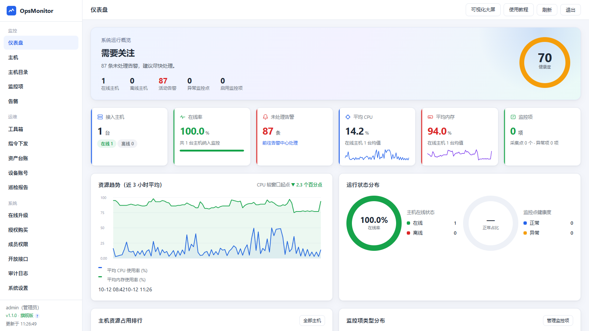
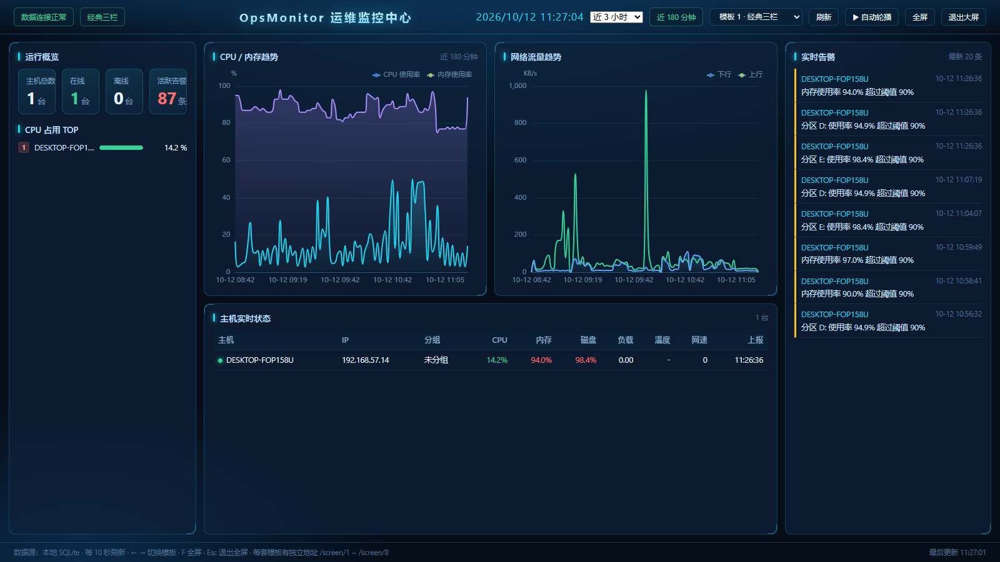
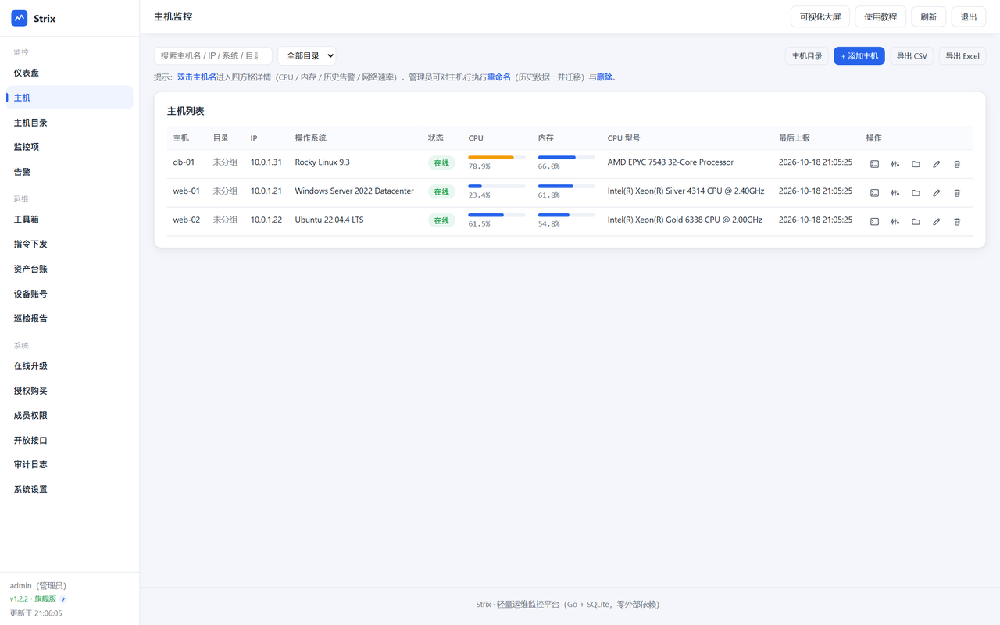
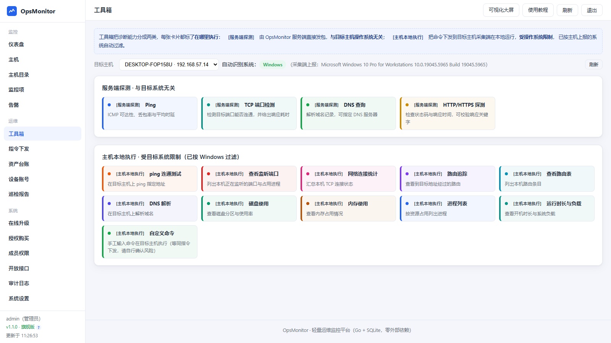
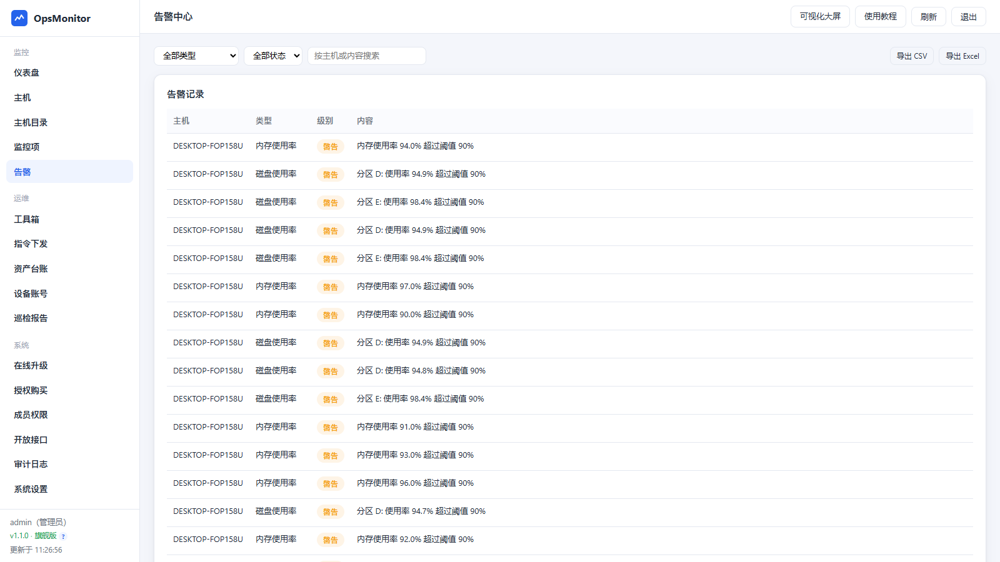
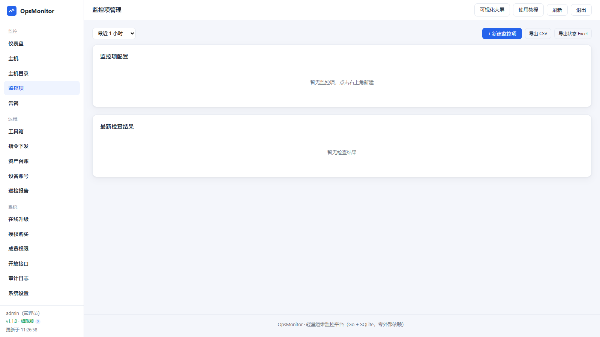

# OpsMonitor

**开箱即用的轻量级分布式运维监控系统** —— 极简部署、自动化运行、零模板零脚本。

Server 端 + Agent 端协同工作，可监控数千台主机。项目地址：<https://github.com/sangxi/OpsMonitor>

```
┌──────────────┐  POST /agent/minTask   ┌───────────────┐     ┌──────────┐
│ opsmonitor-  │───────────────────────►│ opsmonitor-   │────►│ SQLite   │
│ agent        │  JSON + MD5(token) 鉴权 │ server        │     │ 单文件库 │
│ 采集端        │◄───────────────────────│ 服务端 / 控制台 │◄────│ 读写分离 │
│ 本地探针│  GET /agent/tasks       └───┬───────┬───┘     └──────────┘
└──────────────┘                            │       │ 平台代拉（可选）
                                    内嵌静态资源     │       │
                            Web 控制台 + 大屏 + 教程   ▼       ▼
                              （浏览器）      ┌──────────────────┐
                                                 │ 授权系统（独立）   │
                                                 └──────────────────┘
```
### 重要信息

> 浏览器打开 `http://<服务器IP>:9999`，默认账号 `admin / opsmonitor`。

## 界面预览

| 控制台 · 仪表盘 | 可视化大屏（8 套模板） |
| --- | --- |
|  |  |

| 主机监控 | 工具箱 |
| --- | --- |
|  |  |

| 告警中心 | 监控项管理 |
| --- | --- |
|  |  |

## 核心特性

- **极轻量**：Go 语言 + SQLite 单文件，服务端常驻内存 20MB 以内，无 JDK / Tomcat / MySQL
- **开箱即用**：一个二进制 + 一个数据文件即可跑完整套监控，无需初始化数据库、无需模板脚本
- **零 CDN 依赖**：控制台、大屏与教程的全部前端资源（含 ECharts）内嵌为本地静态资源，内网离线可用
- **跨平台一致**：采集端基于 gopsutil 抽象，Linux / Windows / macOS / Unix 行为一致
- **单文件静态部署**：全平台产物均为 `CGO_ENABLED=0` 纯静态二进制，不依赖 glibc / 系统库版本 ——
  Debian、Ubuntu、CentOS 7+、RHEL、Rocky、Fedora、openEuler、麒麟、统信、Alpine 都能直接跑
- **上报可调**：默认每分钟上报一次，间隔由平台统一下发，改配置不用登主机、不用重启
- **部署即用**：支持 Docker Compose / 1Panel / 宝塔面板 / docker / 二进制直接运行，全中文 UI

## 二开版本更新（1.1.1 → 1.1.4）

| 版本 | 重点 |
| --- | --- |
| 1.1.1 | 采集端发布物按 5 个平台（linux/amd64、linux/arm64、darwin/amd64、darwin/arm64、windows/amd64）逐个补拉，修复「Linux 服务端装不上 Windows 采集端 / 授权系统尚未发布该平台」；补拉在后台执行，避免「立即检查更新」被网关超时（HTTP 524）拖死；`-public-url` 配成回环/内网/CGNAT 地址时启动告警 |
| 1.1.2 | 控制台登录失败明确提示原因（用户名或密码错误 / 账号已停用）；内嵌前端资源统一 `Cache-Control: no-cache`，升级二进制后浏览器/反向代理不会再用旧前端 |
| 1.1.3 | 平台自升级后自动重启生效（systemd `Restart=always` / Docker Compose `restart: unless-stopped` / 手工 `nohup` 自拉起，启动失败自动回滚 `.bak`）；新增 `-hub-restart` / `OPSM_HUB_RESTART` |
| 1.1.4 | 控制台「在线升级」「授权购买」页不再展示授权中心域名，也去掉了跳转到授权站的按钮（授权站遭 DDoS 期间降低暴露面），保留机器码与同步状态；前端加 `SHOW_HUB_URL` 开关，排障时可改回显示 |

当前版本 **1.1.4**（构建时间 2026-10-13T13:01:08）。版本沿革：官方 1.0.3 → 二开 1.1.0 → 1.1.1 → 1.1.2 → 1.1.3 → 1.1.4。

## 监控能力

### 核心指标

| 指标 | 说明 |
| --- | --- |
| CPU 使用率 | 采样 1 秒取平均 |
| CPU 温度 | 读取内核 hwmon 温度通道，取 CPU 相关传感器最大值 |
| 内存使用率 | 物理内存占用百分比 |
| 磁盘容量 | 逐分区容量与使用率 |
| 磁盘 IO | 读写速率（KB/s）与 IOPS |
| 硬盘 SMART | 整体健康度，需要 smartmontools |
| 系统负载 | 1 / 5 / 15 分钟负载（Windows 恒为 0） |
| MAC 地址 | 主网卡物理地址 |
| 连接数量 | TCP 连接总数与已建立数 |
| 网卡流量 | 上下行速率（KB/s）与包速率 |
| 硬件系统信息 | 操作系统、CPU 型号、核数、主机名 |

> CPU 温度与 SMART 依赖物理硬件。虚拟机与云主机通常没有温度传感器，云盘也不暴露 SMART，
> 此时这两项显示为「未采集」，**不会**被判定为异常。

### 资源监控

| 类型 | 说明 |
| --- | --- |
| 服务器进程应用 | 进程存活检查（按名称），异常时可自动执行恢复命令 |
| 文件防篡改 | SHA256 指纹基线比对，默认改动后持续告警直到还原 |
| 端口监听 | 本地端口监听检查 |
| 日志文件 | 关键字与正则增量监控；Nginx access log 统计请求量、5xx 错误率、Top IP / Top 路径 |
| Docker 容器 | 容器数量与状态；指定容器后可采集 CPU 与内存并设阈值 |
| 数据库 | MySQL / Redis / Kafka / RabbitMQ / Elasticsearch 真实建连探测 |
| 数据表 | MySQL 真实连接并执行 SQL，可做行数与状态校验 |
| 服务接口 API | HTTP 接口可用性与状态码校验，支持期望状态码 |

### 服务端探针

`icmp` `tcp` `httpapi` `snmp` `mysql` `redis` `kafka` `rabbitmq` `elasticsearch`
`k8s` `ftp` `ssh` `sftp` `ipmi`

### 可视化与告警

- **可视化大屏**：8 套 ECharts 模板，支持全屏投屏，**每套模板有独立地址**（`/screen/1` ~ `/screen/8`）
- **统计分析图表**：CPU / 内存 / 磁盘 IO / 网络流量 / 系统负载趋势，时间窗口 1 小时 ~ 7 天可切
- **指令下发批量执行**：向指定主机批量下发 shell 命令，回传退出码与输出，支持超时判定
- **告警信息推送**：邮件（明文 / STARTTLS / 隐式 TLS）、钉钉、企业微信、飞书、Slack、通用 Webhook
- **内置使用教程**：控制台顶栏「使用教程」或直接访问 `/docs`，含各系统部署指南与文件挂载清单

## 快速开始

完整部署方案见 [DEPLOY.md](DEPLOY.md)。

### Docker Compose（推荐）

```bash
mkdir -p /opt/opsmonitor/data && cd /opt/opsmonitor
# 按 DEPLOY.md 编写 docker-compose.yml 后
docker compose up -d
docker compose logs -f --tail=100
```

### 二进制

```bash
./build.sh                # 当前平台，产物在 bin/
./build.sh all            # 交叉编译 linux/darwin/windows (amd64/arm64)，产物在 dist/
```

```bash
./bin/opsmonitor-server -addr :9999 -db ./data/opsmonitor.db -token opsmonitor -public-url http://<服务器IP>:9999
```

### 接入采集端

在控制台 **监控 → 添加主机** 页面选好系统、架构、主机名后直接复制命令。Linux / macOS：

```bash
curl -fsSL "http://<服务器IP>:9999/install.sh?wgToken=<通信密钥MD5>&name=web-01" | sudo bash
```

Windows 用**管理员** PowerShell：

```powershell
Invoke-Expression (Invoke-WebRequest -UseBasicParsing "http://<服务器IP>:9999/install.ps1?wgToken=<通信密钥MD5>&name=win-01").Content
```

脚本自动完成：识别系统与架构 → 查询下发版本 → 下载二进制 → 校验 SHA256 →
拉取平台下发的运行配置 → 注册开机自启的系统服务（systemd / launchd / 计划任务）。

**完整部署方案见 [DEPLOY.md](DEPLOY.md)** —— 含容量规划、反向代理、备份恢复、升级回滚与排障手册。

> 各平台的**可执行部署脚本**在 [`deploy/`](deploy/) 目录：`deploy/linux`、`deploy/windows`、`deploy/macos`、`deploy/docker`。
> 图文部署教程（选型 / 四平台步骤 / 兼容矩阵 / 排障）作为**独立静态站点**单独维护，不在本仓库内。

## 配置项摘要

### 服务端 `opsmonitor-server`

| 参数 | 环境变量 | 默认值 | 说明 |
| --- | --- | --- | --- |
| `-addr` | `OPSM_ADDR` | `:9999` | HTTP 监听地址 |
| `-db` | `OPSM_DB` | `./data/opsmonitor.db` | SQLite 文件路径 |
| `-token` | `OPSM_TOKEN` | `opsmonitor` | 采集端通信密钥，两端必须一致 |
| `-user` / `-pass` | `OPSM_ADMIN_USER` / `OPSM_ADMIN_PASS` | `admin` / `opsmonitor` | 控制台账号（仅首次启动生效） |
| `-retention` | `OPSM_RETENTION` | `30` | 历史数据保留天数，0 表示永久 |
| `-public-url` | `OPSM_PUBLIC_URL` | 自动反推 | 对外访问地址，反向代理下务必显式指定 |
| `-offline` | `OPSM_OFFLINE_SEC` | `180` | 超过该秒数未上报判定离线 |
| `-cpu-alert` / `-mem-alert` / `-disk-alert` | `OPSM_CPU_ALERT` 等 | `90` | 告警阈值（%） |
| `-load-alert` | `OPSM_LOAD_ALERT` | `10` | 系统负载告警阈值 |
| `-alert-cooldown` | `OPSM_ALERT_COOLDOWN_MIN` | `10` | 同类告警去重冷却（分钟） |
| `-release-dir` | `OPSM_RELEASE_DIR` | 空 | 采集端发布物缓存目录（默认由程序内部决定） |
| `-login-alert` | `OPSM_LOGIN_ALERT` | `true` | 控制台登录失败是否推送告警 |
| `-read-conns` | `OPSM_READ_CONNS` | `8` | SQLite 读连接数 |
| `-write-queue` | `OPSM_WRITE_QUEUE` | `8192` | SQLite 写队列长度 |
| `-probe-workers` | `OPSM_PROBE_WORKERS` | `64` | 服务端探针并发数 |
| `-purge` | `OPSM_PURGE_INTERVAL` | `3600` | 历史数据清理间隔（秒） |
| `-license-secret` | `OPSM_LICENSE_SECRET` | 空 | 旧格式授权码（HMAC）校验密钥，存量旧码换完后即可去掉 |
| `-license` | `OPSM_LICENSE_KEY` | 空 | 手工导入的授权码 |
| `-license-machine` | `OPSM_LICENSE_MACHINE` | 空 | 机器码（Docker 等环境需固定，否则授权失效） |
| `-free-hosts` | `OPSM_LICENSE_FREE_HOSTS` | `10` | 免费档主机数上限 |
| `-free-users` | `OPSM_LICENSE_FREE_USERS` | `3` | 免费档控制台账号数上限 |
| `-hub` | `OPSM_HUB` | 默认已内置授权中心地址；留空=完全离线 | 授权系统地址，不配则纯离线单机模式 |
| `-hub-token` | `OPSM_HUB_TOKEN` | 留空用内置令牌 | 访问授权系统的令牌 |
| `-hub-interval` | `OPSM_HUB_INTERVAL_MIN` | `5` 分钟 | 向授权系统轮询间隔（分钟） |
| `-hub-auto-update` | `OPSM_HUB_AUTO_UPDATE` | `download` | 平台自升级策略：`download` 自动下载并就位 / `check` 只提示不下载 / `off` 关闭 |
| `-hub-restart` | `OPSM_HUB_RESTART` | `auto` | 自升级后是否自动重启生效：`auto` 自动重启 / `off` 只替换文件不重启（需人工重启） |
| `-hub-ua` | `OPSM_HUB_UA` | 空 | 访问授权系统时的自定义 User-Agent |
| `-version` | - | - | 打印版本后退出 |

完整清单见 [DEPLOY.md](DEPLOY.md#六配置项完整清单)。

### 采集端 `opsmonitor-agent`

| 参数 | 环境变量 | 默认值 | 说明 |
| --- | --- | --- | --- |
| `-server` | `OPSM_SERVER` | `http://127.0.0.1:9999` | 服务端地址 |
| `-token` | `OPSM_TOKEN` | `opsmonitor` | 与服务端一致的通信密钥 |
| `-token-hash` | - | 空 | 通信密钥的 MD5，与 `-token` 二选一 |
| `-name` | `OPSM_HOSTNAME` | 本机主机名 | 平台显示名称 |
| `-interval` | `OPSM_INTERVAL` | `60` | 上报间隔（秒），平台下发时被覆盖 |
| `-update` | `OPSM_UPDATE` | `auto` | `auto` 自动升级 / `check` 只检查 / `off` 关闭 |
| `-remote-config` | `OPSM_REMOTE_CONFIG` | `auto` | `auto` 接受平台下发 / `off` 只用本地参数 |

> 带「平台下发时被覆盖」标记的参数只是本地兜底值。用 `-remote-config off` 可完全以本地参数为准。

## 目录结构

```
OpsMonitor
├── build.sh                     # 本平台 / 全平台交叉编译
├── release.sh                   # 交叉编译 + 上传到授权系统，一条命令完成版本发布
├── cmd/opsmonitor-server        # 服务端（平台）入口
├── cmd/opsmonitor-agent         # 采集端入口
├── internal/config              # 命令行与环境变量配置
├── internal/version             # 版本号常量与版本比较
├── internal/license             # 授权码验签（Ed25519 + 旧格式 HMAC 兼容）、机器码、档位与配额
├── internal/model               # 上报协议与接口数据模型
├── internal/store               # SQLite 存储、查询、告警判定、业务 CRUD、审计
├── internal/probe               # 服务端探针注册表
├── internal/poller              # 服务端探测调度器
├── internal/notify              # 告警推送：邮件 + 群机器人
├── internal/server              # HTTP 路由、鉴权、会话、导出、开放接口
│   └── web/                     # 内嵌前端（控制台 + 大屏 + 教程 + ECharts）
├── internal/agent               # 指标采集、本地探针、指令通道、硬件指标
└── DEPLOY.md                    # 部署方案
```

## 配套系统

版本发布与授权签发是**另一套独立系统**（工程目录 `../opsmonitor-hub`），本工程不包含它的任何代码。
不配 `-hub` 就是**完全离线的单机模式**，功能不受影响；配了之后平台可从授权系统**代拉**最新版本与本机授权，
内网平台与采集端都不需要访问公网。

授权码采用 Ed25519 签名：**私钥只在授权中心**，本平台二进制里**只内置公钥**（`internal/config/licensekey.go`，
改公钥需重新编译），因此只能验签、**不具备签发能力**——即使二进制被逆向也伪造不出授权码。
启动日志里的「授权验签公钥指纹」应与授权中心一致；对不上就是把公钥抄错了。历史格式 `WGC-` / `OPSM1-` / `OPSM-`
（HMAC）继续只读兼容，靠 `-license-secret` 校验，存量旧码换完后即可取消该参数。

## 安全建议

1. **首次部署立即修改默认账号密码与通信密钥**（`-pass` / `-token`）
2. 反向代理场景下启用 HTTPS，并显式配置 `-public-url` / `OPSM_PUBLIC_URL`
3. 不要把 9999 端口暴露到公网；跨网段访问走内网或 VPN
4. `/api/agent/install` 会返回通信密钥，仅管理员与运维可读，只读账号返回 403
5. 定期通过控制台「审计日志」复核操作留痕

## 尚未实现

网络拓扑图、WebSSH 终端、任务编排与批量巡检计划。

另外，控制台目前没有删除主机的入口 —— 主机只由采集端上报注册，历史数据按服务端保留天数自动清理。

## License

Apache-2.0
